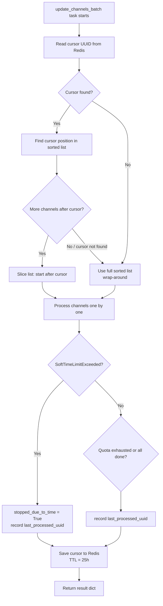

# Gradual Resumable Channel Update

## Table of Contents

1. [Overview](#overview)
2. [Problem Statement](#problem-statement)
3. [Solution Overview](#solution-overview)
4. [Current System Analysis](#current-system-analysis)
5. [Technical Design](#technical-design)
6. [Implementation Phases](#implementation-phases)
7. [Performance Considerations](#performance-considerations)
8. [Testing Strategy](#testing-strategy)
9. [Risks and Mitigation](#risks-and-mitigation)
10. [Conclusion](#conclusion)

## Overview

This feature fixes the `TimeLimitExceeded` crash in the `update_channels_batch` Celery task by making channel updates **gradual and resumable**. Each task run processes as many channels as it can within the 9-minute soft time limit, then saves a cursor to Redis pointing to the last processed channel. The next scheduled run picks up from that cursor, ensuring all channels are eventually updated across consecutive runs without any single task exceeding Celery's hard time limit.

## Problem Statement

### Immediate Issue

The `celery_worker` container crashes with:

```
billiard.exceptions.TimeLimitExceeded: TimeLimitExceeded(600,)
```

This is Celery's hard kill at 600 seconds. The task should have been stopped gracefully at the 540-second soft limit (`SoftTimeLimitExceeded`), but the exception is silently swallowed in three places in the service layer, allowing the loop to continue until billiard forcefully terminates the worker process.

### Root Cause: `SoftTimeLimitExceeded` Is Swallowed

Three broad `except Exception` clauses catch `SoftTimeLimitExceeded` before it can propagate up to the task's loop:

1. `ChannelUpdateService.update_channel()` — delegates the exception to `_handle_update_error`, which treats it as an unknown error, increments the channel's `failed_update_count`, and returns a partial `ChannelUpdateResult`. The batch loop then continues to the next channel.
2. `ChannelUpdateService._fetch_new_videos()` — swallowed and returns `0`.
3. `YouTubeService.get_channel_videos()` — swallowed and breaks the inner page loop, but the caller continues.

### Secondary Issue: No Progress Persistence

Even if the soft limit were handled, each new task run would restart from scratch. On large channel sets, consecutive crashes mean some channels are never processed while the first N channels are repeatedly updated. There is no mechanism to distribute the work across multiple runs.

### User Impact

- Worker process is killed, potentially leaving a task result as "lost" in Celery
- Channels processed near the end of the sorted order never get updated
- Incorrect `failed_update_count` increments on channels that hit the time limit (treated as genuine update failures)

## Solution Overview

### Key Capabilities

**Fix `SoftTimeLimitExceeded` Propagation**:
- Re-raise `SoftTimeLimitExceeded` in the three locations where it is currently swallowed so it can propagate up to `update_channels_batch` in the service layer
- Catch it there to return a partial result with `stopped_due_to_time: true` and `last_processed_uuid`
- Add safety-net handlers in each task function

**Resumable Cursor**:
- Store the UUID of the last processed channel in Redis after each `update_channels_batch` run
- On the next run, find the cursor in the deterministically sorted channel list and resume from the next channel
- When the cursor points to the last channel, wrap around to the beginning automatically

**Deterministic Ordering**:
- Order channels by `last_updated ASC NULLS FIRST, uuid` so never-updated channels are prioritized, and the ordering is stable across runs

**Redis Cache Backend**:
- Configure Django's cache to use Redis (currently defaults to in-memory, which doesn't persist between task runs)

## Current System Analysis

### Celery Configuration (`backend/youtube_gallery/celery.py`)

- Hard time limit: `task_time_limit=600` (10 minutes — kills the worker)
- Soft time limit: `task_soft_time_limit=540` (9 minutes — raises `SoftTimeLimitExceeded` in the task)
- `update_channels_batch` runs in the `bulk` queue via `task_routes`

### Beat Schedule (`backend/videos/management/commands/setup_periodic_tasks.py`)

- `update_channels_batch` runs daily at 2 AM UTC
- `update_priority_channels_async` runs hourly (independent, uses its own priority logic)

### `update_channels_batch` Task (`backend/videos/tasks.py`)

Currently queries all available channels with no ordering and no cursor:

```python
channels = Channel.objects.filter(is_available=True)
result = channel_updater.update_channels_batch(channels)
```

### `ChannelUpdateService.update_channels_batch` (`backend/videos/services/channel_updater.py`)

Processes channels sequentially with quota awareness but no time awareness. Has no mechanism to report which channel it stopped at.

### Django Cache

No `CACHES` setting is configured — Django defaults to in-memory cache, which does not persist between Celery task invocations. The `redis` package (5.0.1) is already installed.

### `update_channels_batch` Task — Current Signature (`backend/videos/tasks.py` line 74)

```python
@shared_task(bind=True, name="videos.tasks.update_channels_batch")
def update_channels_batch(self: Task, channel_uuids: Optional[list[str]] = None) -> dict[str, Any]:
```

Current return dict (lines 89–98) — fields that exist today:
```python
{
    "status": "success",
    "task_id": self.request.id,
    "channels_processed": result["processed"],
    "successful_updates": result["successful"],
    "failed_updates": result["failed"],
    "quota_used": result["quota_used"],
    "stopped_due_to_quota": result["stopped_due_to_quota"],
    "quota_summary": result["quota_summary"],
}
```
The new design adds `"stopped_due_to_time"` and `"last_processed_uuid"` to this dict.

### All Tasks Requiring `SoftTimeLimitExceeded` Safety Nets (`backend/videos/tasks.py`)

Four tasks in addition to `update_channels_batch` need the `except SoftTimeLimitExceeded` guard before their broad `except Exception` handler:
- `update_single_channel`
- `update_priority_channels_async`
- `retry_unavailable_channels`
- `cleanup_orphaned_channels`

`debug_celery_task` is excluded — it is a trivial one-liner with no try/except at all and no long-running operations; adding a guard would be dead code.

All four affected tasks follow the same pattern: `except Exception as exc` that checks `isinstance(exc, (ConnectionError, TimeoutError))` for retries, then returns an error dict.

### `ChannelUpdateService.update_channels_batch` — Internal Slicing (`backend/videos/services/channel_updater.py` lines 395–440)

The service applies **two layers of slicing** to the incoming channel list:
1. `channels_list = list(channels)` — materializes the iterable
2. `channels_to_process = channels_list[:optimal_batch_size]` — clips to quota-optimized batch size; if `optimize_batch_size` returns 0, `channels_to_process` is `[]` and nothing is processed

This means `last_processed_uuid` tracks the last channel processed within the quota-clipped subset, which is correct — the cursor represents actual progress regardless of whether stopping was due to quota or time.

There are also **two return paths** in this method:
1. **Early return** (line 396–404): when `channels` is empty/falsy — returns a minimal dict without `quota_summary`
2. **Normal return** (lines 432–440): full result dict

Both return paths need `"stopped_due_to_time": False` and `"last_processed_uuid": None` added (defaulting to no-stop state for the early return).

## Technical Design

### Flow Diagram



### Database Changes

None — the cursor is stored entirely in Redis.

### Django Cache Configuration (`backend/youtube_gallery/settings.py`)

Add after the `REDIS_*` variable definitions:

```python
CACHES = {
    "default": {
        "BACKEND": "django.core.cache.backends.redis.RedisCache",
        "LOCATION": f"redis://{REDIS_USER}:{REDIS_PASSWORD}@{REDIS_HOST}:{REDIS_PORT}/{REDIS_DB}",
    }
}
```

Uses Django's built-in Redis cache backend (available since Django 4.0, project uses 5.2). Shares the same Redis DB as Celery — no key conflicts since Django auto-prefixes cache keys.

### Service Layer Changes (`backend/videos/services/channel_updater.py`)

**`update_channel()`** (lines 75–96) — current structure is a single `except Exception as e` that calls `_handle_update_error`. Add `SoftTimeLimitExceeded` re-raise before it. `SoftTimeLimitExceeded` is not a subclass of any of the project's custom exception types, so without this fix it falls into `_handle_update_error`'s `else` branch and **incorrectly increments `failed_update_count`**:

```python
from celery.exceptions import SoftTimeLimitExceeded

def update_channel(self, channel):
    try:
        ...  # existing body unchanged
    except SoftTimeLimitExceeded:
        raise
    except Exception as e:
        return self._handle_update_error(channel, e)
```

**`_fetch_new_videos()`** (lines 192–235) — current structure is a single `except Exception as e` that returns 0. Add re-raise before it:

```python
    except SoftTimeLimitExceeded:
        raise
    except Exception as e:
        print(f"WARNING: Failed to fetch new videos for channel {channel.uuid}: {str(e)}")
        return 0
```

**`update_channels_batch()`** (lines 395–440) — add `last_processed_uuid` and `stopped_due_to_time` tracking. The variable `channels_to_process` is already used in the existing code (it's the quota-clipped slice). Changes:

1. Update the **early empty-channels return** (lines 396–404) to include new fields:
```python
return {
    "processed": 0,
    "successful": 0,
    "failed": 0,
    "quota_used": 0,
    "stopped_due_to_quota": False,
    "stopped_due_to_time": False,
    "last_processed_uuid": None,
    "results": [],
    "quota_summary": self.quota_tracker.get_usage_summary(),
}
```

2. Add variables and wrap the loop in a try/except:
```python
last_processed_uuid: Optional[str] = None
stopped_due_to_time = False

try:
    for channel in channels_to_process:
        if not self.quota_tracker.can_make_request("channels.list"):
            stopped_due_to_quota = True
            break
        result = self.update_channel(channel)
        last_processed_uuid = str(channel.uuid)
        results.append(result)
        if result.success:
            successful_updates += 1
        else:
            failed_updates += 1
        total_quota_used += result.quota_used
except SoftTimeLimitExceeded:
    stopped_due_to_time = True

return {
    "processed": len(results),
    "successful": successful_updates,
    "failed": failed_updates,
    "quota_used": total_quota_used,
    "stopped_due_to_quota": stopped_due_to_quota,
    "stopped_due_to_time": stopped_due_to_time,
    "last_processed_uuid": last_processed_uuid,
    "results": results,
    "quota_summary": self.quota_tracker.get_usage_summary(),
}
```

Note: `last_processed_uuid` is set **after** `self.update_channel(channel)` returns, so if `SoftTimeLimitExceeded` is raised inside `update_channel`, the cursor points to the **previous successfully completed channel**. This is correct — partial updates to the current channel are not tracked.

### YouTube Service Changes (`backend/videos/services/youtube.py`)

**`get_channel_videos()`** (lines 428–500) — this is a generator with a `while True` loop. The current broad `except Exception: break` is at the bottom of the while loop body. Re-raise `SoftTimeLimitExceeded` before it so it propagates up to `_fetch_new_videos` and then to the caller:

```python
        except SoftTimeLimitExceeded:
            raise
        except Exception:
            break
```

This is critical: without the re-raise, `SoftTimeLimitExceeded` raised during a YouTube API call (e.g. during `playlist_request.execute()`) would silently break the generator loop, causing `_fetch_new_videos` to return a partial count of 0 and the batch loop to continue to the next channel.

### Task Changes (`backend/videos/tasks.py`)

**New constants**:
```python
CHANNEL_UPDATE_CURSOR_KEY = "channel_update_cursor"
CHANNEL_UPDATE_CURSOR_TTL = 25 * 60 * 60  # 25 hours
```

**`update_channels_batch` task** — cursor read/write, deterministic ordering, and soft-limit handler:
```python
from celery.exceptions import SoftTimeLimitExceeded
from django.core.cache import cache
from django.db.models import F

@shared_task(bind=True, name="videos.tasks.update_channels_batch")
def update_channels_batch(self, channel_uuids=None):
    try:
        is_full_batch = not channel_uuids
        if is_full_batch:
            channels = list(
                Channel.objects.filter(is_available=True)
                .order_by(F("last_updated").asc(nulls_first=True), "uuid")
            )
            cursor_uuid = cache.get(CHANNEL_UPDATE_CURSOR_KEY)
            if cursor_uuid:
                try:
                    cursor_index = next(i for i, c in enumerate(channels) if str(c.uuid) == cursor_uuid)
                    remaining = channels[cursor_index + 1:]
                    if remaining:
                        channels = remaining
                    # else cursor was at end — wrap around, use full list
                except StopIteration:
                    pass  # cursor channel gone, start from beginning
        else:
            channels = list(Channel.objects.filter(uuid__in=channel_uuids, is_available=True))

        youtube_service = YouTubeService(api_key=settings.YOUTUBE_API_KEY)
        quota_tracker = QuotaTracker()
        channel_updater = ChannelUpdateService(youtube_service, quota_tracker)
        result = channel_updater.update_channels_batch(channels)

        if is_full_batch and result.get("last_processed_uuid"):
            cache.set(CHANNEL_UPDATE_CURSOR_KEY, result["last_processed_uuid"], CHANNEL_UPDATE_CURSOR_TTL)

        return {
            "status": "success",
            "task_id": self.request.id,
            "channels_processed": result["processed"],
            "successful_updates": result["successful"],
            "failed_updates": result["failed"],
            "quota_used": result["quota_used"],
            "stopped_due_to_quota": result["stopped_due_to_quota"],
            "stopped_due_to_time": result.get("stopped_due_to_time", False),
            "last_processed_uuid": result.get("last_processed_uuid"),
            "quota_summary": result["quota_summary"],
        }

    except SoftTimeLimitExceeded:
        return {"status": "partial", "message": "Stopped due to soft time limit", "task_id": self.request.id}
    except Exception as exc:
        ...  # unchanged
```

**Four other tasks** — add `SoftTimeLimitExceeded` safety net before the broad `except Exception` in `update_single_channel`, `update_priority_channels_async`, `retry_unavailable_channels`, and `cleanup_orphaned_channels`. All four have the same handler structure — `except Exception as exc` with a `ConnectionError/TimeoutError` retry branch. Insert before each:

```python
except SoftTimeLimitExceeded:
    return {"status": "partial", "message": "Stopped due to soft time limit", "task_id": self.request.id}
except Exception as exc:
    ...  # existing ConnectionError/TimeoutError retry + error dict return unchanged
```

### Cursor Wrap-Around Behavior

| Scenario | Cursor position | Next run starts at |
|---|---|---|
| Stopped mid-batch (time/quota) | Channel 40 of 100 | Channel 41 |
| Processed all channels | Channel 100 of 100 | Channel 1 (wrap) |
| Cursor channel was deleted | N/A (StopIteration) | Channel 1 |
| No cursor in Redis | N/A | Channel 1 |

The TTL (25h) is a background safety net — if the task skips a day, the cursor naturally expires so the next run starts fresh.

## Implementation Phases

### Phase 1 — Fix `SoftTimeLimitExceeded` propagation

All four steps are **independent and can be done in parallel** (different files/methods, no mutual dependencies):

| Step | File | Change | Parallel? |
|---|---|---|---|
| 1a | `backend/videos/services/youtube.py` | Re-raise `SoftTimeLimitExceeded` in `get_channel_videos` (lines 428–500) | ✓ parallel |
| 1b | `backend/videos/services/channel_updater.py` | Re-raise in `update_channel` (lines 75–96) | ✓ parallel |
| 1c | `backend/videos/services/channel_updater.py` | Re-raise in `_fetch_new_videos` (lines 192–235) | ✓ parallel with 1b, same file — do together |
| 1d | `backend/videos/services/channel_updater.py` | Add `stopped_due_to_time` + `last_processed_uuid` to both return paths of `update_channels_batch` (lines 395–440) | ✓ parallel with 1b/1c, same file — do together |
| 1e | `backend/videos/tasks.py` | Add `SoftTimeLimitExceeded` safety nets to `update_single_channel`, `update_priority_channels_async`, `retry_unavailable_channels`, `cleanup_orphaned_channels` | ✓ parallel with 1a/1b/1c/1d |

Steps 1b, 1c, and 1d all touch `channel_updater.py` and should be done in a single edit pass. Step 1a touches `youtube.py`. Step 1e touches `tasks.py`. All three files can be edited simultaneously.

**Phase 1 tests** (add to `backend/videos/tests/test_channel_update_service.py`): tests 1–4 from the Testing Strategy above. Run `python manage.py test videos.tests.test_channel_update_service` to verify before proceeding.

### Phase 2 — Add Redis cache and cursor logic

Steps are **sequential** (2b depends on 2a):

| Step | File | Change | Order |
|---|---|---|---|
| 2a | `backend/youtube_gallery/settings.py` | Add `CACHES` dict with Redis backend (after `REDIS_*` variable block, lines ~192–211) | first |
| 2b | `backend/videos/tasks.py` | Add `CHANNEL_UPDATE_CURSOR_KEY` / `CHANNEL_UPDATE_CURSOR_TTL` constants; add new imports (`cache`, `F`, `SoftTimeLimitExceeded`); rewrite `update_channels_batch` task body with cursor logic and deterministic ordering | after 2a |

**Phase 2 tests** (new file `backend/videos/tests/test_channel_update_task.py`): tests 5–9 from the Testing Strategy above. Run `python manage.py test videos.tests.test_channel_update_task`.

## Performance Considerations

**Channel list load**: All available channels are loaded into memory at task start to determine the cursor position. For typical deployments (hundreds to low thousands of channels) this is negligible. If the channel count grows into tens of thousands, replace the in-memory list scan with a keyset query using `last_updated`/`uuid` as the pagination key.

**Redis cursor operations**: A single `GET` and `SET` per task run — effectively zero cost.

**Ordering change**: Adding `ORDER BY last_updated ASC NULLS FIRST, uuid` to the daily batch query. The existing performance migration `backend/users/migrations/0003_add_performance_indexes.py` does **not** cover `Channel.last_updated` — it only indexes `UserChannel(user_id, is_active)`, `UserVideo(user_id, is_watched)`, and tag-related fields. For small channel counts (hundreds to low thousands) PostgreSQL will use a sequential scan which is fine. If performance becomes noticeable, add a new migration with:

```python
migrations.RunSQL(
    "CREATE INDEX IF NOT EXISTS idx_channels_last_updated_uuid ON videos_channel (last_updated ASC NULLS FIRST, uuid);",
    "DROP INDEX IF EXISTS idx_channels_last_updated_uuid;",
)
```

This migration is **optional** and can be deferred unless query times are measurable. It is not part of Phase 1 or 2.

## Testing Strategy

### Backend

Tests belong in `backend/videos/tests/test_channel_update_service.py` (the existing 40-test file for `ChannelUpdateService`) and/or a new `test_channel_update_task.py` file in `backend/videos/tests/` for the task-level cursor logic. The test directory has no root-level `__init__.py` so new files are auto-discovered.

**Phase 1 — propagation tests** (add to `test_channel_update_service.py`):
1. `test_soft_time_limit_propagates_from_update_channel`: mock `SoftTimeLimitExceeded` raised inside `_fetch_channel_data`; assert `update_channel` re-raises it (not returns a `ChannelUpdateResult`).
2. `test_soft_time_limit_propagates_from_fetch_new_videos`: mock `SoftTimeLimitExceeded` raised inside `get_channel_videos`; assert `_fetch_new_videos` re-raises it.
3. `test_update_channels_batch_stopped_due_to_time`: mock `update_channel` to raise `SoftTimeLimitExceeded` after 2 channels; assert return dict has `stopped_due_to_time=True`, `last_processed_uuid` equal to the second channel's UUID, and `processed=2`.
4. `test_soft_time_limit_does_not_increment_failed_update_count`: after a run that raises mid-loop, assert channel's `failed_update_count` is unchanged.

**Phase 2 — cursor logic tests** (add to `test_channel_update_task.py`):
5. `test_cursor_written_to_cache_after_time_stop`: call the task; mock service to return `stopped_due_to_time=True, last_processed_uuid="<uuid>"`; assert `cache.set(CHANNEL_UPDATE_CURSOR_KEY, "<uuid>", ...)` was called.
6. `test_cursor_read_and_channels_sliced`: pre-set cursor in cache to channel 3's UUID; call task with 5 channels; assert service receives channels 4–5 only.
7. `test_wrap_around_when_cursor_at_last_channel`: pre-set cursor to last channel UUID; assert service receives all channels (full list, no slice).
8. `test_wrap_around_when_cursor_channel_deleted`: pre-set cursor to a UUID not in the DB; assert service receives full channel list.
9. `test_cursor_not_written_for_explicit_channel_uuids_call`: call task with explicit `channel_uuids` list; assert `cache.set` is NOT called.

### Manual Verification

1. After deploying, check worker logs — `TimeLimitExceeded` should not appear.
2. In Redis: `redis-cli GET :0:channel_update_cursor` (Django prefixes with `:0:` for REDIS_DB=0, which is the default value configured in `settings.py`) — should show the UUID of the last processed channel.
3. Trigger `update_channels_batch` twice in a row — confirm the second run starts at a different channel than the first.
4. Confirm `failed_update_count` is no longer incremented for channels that hit the time limit.

## Risks and Mitigation

| Risk | Mitigation |
|---|---|
| Redis cache key conflicts with Celery broker keys | Django's `RedisCache` namespaces keys with a `:db:` prefix; Celery uses its own serialization format. No collision. |
| Ordering change breaks `update_priority_channels_async` | That task independently sorts channels by priority score and is unaffected. |
| Cursor stuck if daily task is skipped | 25h TTL ensures the cursor expires before the next day's run. |
| Channel list grows too large to load into memory | Rare for this application; if it becomes an issue, replace the in-memory scan with a keyset (`last_updated`, `uuid`) database query. |

## Conclusion

The `TimeLimitExceeded` crash is caused by `SoftTimeLimitExceeded` being silently swallowed in the service layer, allowing the batch loop to run past Celery's hard kill threshold. The fix has two parts: propagating the exception correctly so the loop stops at 540s, and persisting a cursor in Redis so the next scheduled run continues where the previous one left off. The result is a gradual, resumable update cycle that guarantees all channels are processed over time without ever exceeding the time limit.
